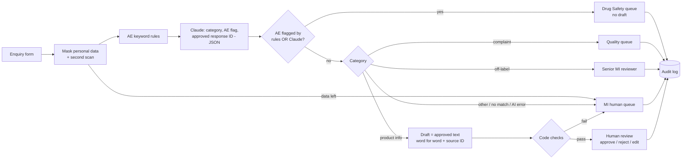

# Pharma Implementation Case — Medical Information triage with a human in the loop

> **Portfolio case on a fictional company; built and tested, not deployed; not legal or medical advice.**
> Nordvale Pharma, its products (Velquanor, Orvatil, Brenquilo), people and all data are invented.

A full implementation case, from discovery to handover: an n8n workflow for a pharmaceutical **Medical Information (MI)** team that sorts incoming enquiries from physicians, pharmacists and patients, sends **possible adverse events straight to Drug Safety**, and prepares reply drafts **only from approved standard responses** — with a person approving every draft and an audit log of every decision.

## The problem

At Nordvale (fictional baseline), MI enquiries are triaged by reading. Whether an enquiry hides a possible adverse event ("my mother got a rash after the tablets, can she take a painkiller with them?") depends on someone noticing it. Safety reporting timelines start when the company receives the information, so a case sitting in the ordinary queue is a compliance problem, not just a slow reply. Replies are copied from old answers with unclear versions, personal data is copied into four places, and there is no record of who approved what. Details: [docs/01_discovery.md](docs/01_discovery.md).

## The solution

Three n8n workflows ([workflow/](workflow/)):

| Workflow | What it does |
|---|---|
| **PIC MI Triage** | Form or webhook intake → masking in code → PII gate → AE keyword rules → Claude classification (JSON) → routing → draft from the approved library → code checks → queue + audit log |
| **PIC Draft Review** | Login-protected form: approve / reject (reason required) / edit (re-checked) → queue update + audit log |
| **PIC Eval** | Runs 26 fictional enquiries and 5 review decisions through the real workflows and scores them |

Full design, data flow and the "AI does / does not" table: [docs/02_solution_design.md](docs/02_solution_design.md).

## Safeguards

- **Two independent AE detectors.** Keyword rules (no AI) and Claude each flag possible adverse events and special situations. Either one is enough. The AI can add a safety flag, never remove one.
- **The AI never writes medical text.** Claude only returns a category, an AE flag, a rationale and the **ID** of an approved response (or `NONE`). The draft is assembled in code, word for word from the library, with `[Source: ID vX]`.
- **No drafts for risky categories.** Adverse events, complaints and off-label questions never get a draft.
- **Data minimisation before AI.** Names, emails, phones, ID numbers and dates of birth are masked; a second scan blocks the AI call if anything is left; contact details stay in one table.
- **Code checks on every draft.** Cited ID + version exists and is approved for that product; no personal data in the AI-bound text; no forbidden phrases ("you should stop…", "completely safe"…).
- **Fail-safe.** AI error, invalid output or a failed check → human queue, never "no action".
- **Human decides, human sends.** Nothing is sent outside. Every routing and review decision is logged with actor, time, decision and source version.

## Test results (real numbers)

Three runs of `PIC Eval` on 26 fictional enquiries (7 possible AEs, 5 of them hidden or "special situations"; 10 planted personal data items; 47 contact fields). Full report with every deviation explained: [results/README.md](results/README.md). Raw exports: [results/test_runs.csv](results/test_runs.csv), [results/test_results_per_case.csv](results/test_results_per_case.csv).

| Metric | Run 1 (v1.0) | Run 2 (v1.1) | Run 3 (v1.1) |
|---|---|---|---|
| Possible AEs routed to Drug Safety | **7 / 7** | **7 / 7** | **7 / 7** |
| …by keyword rules alone / by Claude alone | 7 / 7 · 7 / 7 | 7 / 7 · 7 / 7 | 7 / 7 · 7 / 7 |
| False alarms to Drug Safety | 0 | 1 | 0 |
| Classification accuracy (5 categories) | 25 / 26 | 26 / 26 | 26 / 26 |
| Routed to the expected queue | 25 / 26 | 25 / 26 | 26 / 26 |
| Planted personal data masked before AI | 10 / 10 | 10 / 10 | 10 / 10 |
| Contact fields that reached the AI | 0 of 47 | 0 of 47 | 0 of 47 |
| Drafts with a valid, approved citation | 10 / 10 | 10 / 10 | 10 / 10 |
| Drafts for AE / complaint / off-label | 0 | 0 | 0 |
| Review decisions as expected (incl. 2 blocked) | 5 / 5 | 5 / 5 | 5 / 5 |
| Audit log rows found / expected | 31 / 31 | 31 / 31 | 31 / 31 |

- **No adverse event was missed in any run.**
- **Run 1:** one complaint fell back to the human queue because Claude answered with two JSON blocks; the parser was fixed (v1.1) and the test re-run.
- **Run 2:** one off-label dose question was flagged as a possible AE by Claude (false alarm, safe direction). Not tuned away on purpose; it was not flagged in runs 1 and 3.
- **Run 3:** no deviations. One test enquiry had been reworded to remove a real substance name (details in the report).

## Documents

| Stage | Document |
|---|---|
| 1. Discovery | [docs/01_discovery.md](docs/01_discovery.md) — as-is process, roles, problems, fictional baseline, requirements, success criteria |
| 2. Solution design | [docs/02_solution_design.md](docs/02_solution_design.md) — target process, diagram, routing rules, data flow, human decisions, AI boundaries |
| 3. Automation | [workflow/](workflow/) — three n8n workflows; [data/](data/) — fictional response library and test enquiries |
| 4. Test | [results/README.md](results/README.md) — method, results, deviations, limitations |
| 5. Risk | [docs/03_risk_assessment.md](docs/03_risk_assessment.md) — risk register with controls and test evidence |
| 5. Compliance | [docs/04_compliance.md](docs/04_compliance.md) — GDPR, EU AI Act, pharmacovigilance, with links to EUR-Lex and EMA |
| 5. User guide | [docs/05_user_guide.md](docs/05_user_guide.md) — for the people who handle enquiries |
| 5. Training and handover | [docs/06_training_and_handover.md](docs/06_training_and_handover.md) — training, go-live checklist, hypercare, metrics, handover |
| Learning notes (Polish) | [MECHANIZM_PL.md](MECHANIZM_PL.md) |

## Limitations

- **Portfolio case on a fictional company; built and tested, not deployed; not legal or medical advice.**
- 26 hand-written English test cases; the keyword rules and the cases were written by the same person, so rule recall is an optimistic estimate.
- Masking is rule-based and tuned to the formats in the test set; real data would need wider patterns (and likely a name-recognition step).
- Three test runs only; the model's output on borderline wording varies between runs.
- Review-form login, form UI and email sending were not part of the automated test; the review logic was tested through its test trigger.

## How to import

1. In n8n, create these **data tables** (names must match):
   - `PIC Response Library` — import [data/response_library.csv](data/response_library.csv)
   - `PIC Test Cases` — import [data/test_enquiries.csv](data/test_enquiries.csv) (`expected_ae` as boolean)
   - `PIC Intake` — `enquiry_id, received_at, channel, requester_type, product, contact_name, contact_email, contact_phone` (text), `is_test` (boolean)
   - `PIC Queue` — `enquiry_id, created_at, queue, status, category, ae_terms, rationale, reason, requester_type, product, masked_text, draft_text, source_id, source_version, checks, workflow_version, reviewed_by, reviewed_at, review_note` (text), `ae_rule, ae_ai, is_test` (boolean), `masked_count` (number)
   - `PIC Audit Log` — `enquiry_id, at, actor, action, decision, source_id, source_version, detail, workflow_version` (text)
   - `PIC Test Results` and `PIC Test Runs` — columns as in the two CSV files in [results/](results/)
2. Import the three files from [workflow/](workflow/) (**Workflow → Import from file**).
3. In **PIC MI Triage**, open `Classify with Claude` and select your own Anthropic credential. The exports contain no credentials and no instance URL.
4. In **PIC Eval**, open `Run triage on each case` and `Run review` and pick the imported `PIC MI Triage` and `PIC Draft Review`.
5. Run **PIC Eval** manually. One summary row appears in `PIC Test Runs`.
