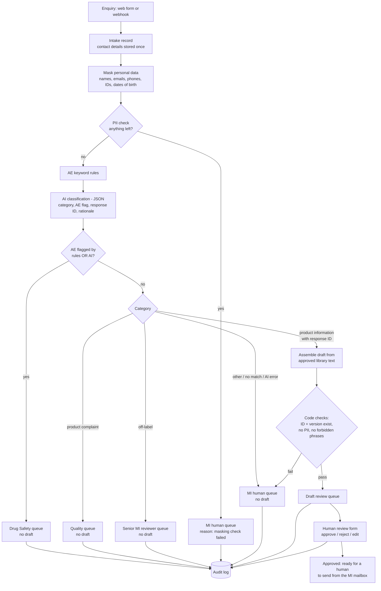

# 02 — Solution design

> Fictional case: Nordvale Pharma, its products and all data are invented. Not legal or medical advice.

## 1. Design principles

1. **Safety first, by construction.** A possible adverse event (AE) is routed to Drug Safety if *either* the keyword rules *or* the AI flags it. The AI can add a safety flag; it can never remove one.
2. **The AI selects, it does not write.** For ordinary questions the model only picks the ID of an approved standard response (or says `NONE`). The reply text is assembled by code from the approved library, word for word. The model has no way to put its own medical wording into a draft.
3. **Minimum data to the model.** Personal data is masked in code before any text leaves the workflow for the AI provider, and a second code check blocks the AI call if anything slipped through.
4. **Fail safe.** Any error, invalid AI output or failed check sends the enquiry to a human queue. No path ends in "no action".
5. **A human decides and sends.** Every draft needs a named reviewer's approval. The workflow never sends anything to a requester.
6. **Everything leaves a trace.** Each routing decision and each human decision writes an audit log row with actor, time, decision and source version.

## 2. Target process (to-be)

If the AI call fails, the enquiry still passes the rule check: a rule hit goes to Drug Safety, anything else goes to the MI human queue.

## 3. Components

| Component | n8n implementation | Purpose |
|---|---|---|
| Intake | Form Trigger + "When executed by another workflow" trigger (used by the test) | Accept the enquiry and its metadata |
| Intake store | Data table `mi_intake` | The only place that holds requester contact details |
| Masking | Code node | Replace personal data with typed placeholders (`[NAME]`, `[EMAIL]`, `[PHONE]`, `[ID_NUMBER]`, `[DATE_OF_BIRTH]`) |
| PII gate | Code node | Re-scan masked text; block the AI call if anything remains |
| AE rules | Code node | Keyword and phrase patterns for possible AEs and special situations (overdose, medication error, pregnancy exposure, lack of effect) |
| AI classification | Claude via n8n, structured JSON output | Category, AE flag, matching response ID, rationale |
| Router | Code node | Applies the routing rules in section 4 |
| Response library | Data table `mi_response_library` | Approved standard responses: ID, version, product, scope, text, approver |
| Draft builder + checks | Code node | Assemble draft from library text; validate ID and version; scan for PII and forbidden phrases |
| Queues | Data table `mi_queue` | One row per enquiry with its queue, status and evidence |
| Review | Separate workflow with a Form Trigger | Reviewer approves, rejects or edits a draft |
| Audit log | Data table `mi_audit_log` | Append-only record of every decision |

## 4. Routing rules (evaluated in this order)

| # | Condition | Queue | Draft? |
|---|---|---|---|
| 1 | PII still present after masking | MI human queue | no |
| 2 | AE keyword rule hit **or** AI `ae_suspected = true` **or** AI category = adverse event | **Drug Safety** | **no** |
| 3 | Category = product complaint | Quality | no |
| 4 | Category = off-label question | Senior MI reviewer | no |
| 5 | AI output missing or invalid | MI human queue | no |
| 6 | Category = product information and response ID found in library for that product | Draft review | yes, from library |
| 7 | Anything else (other, no matching response) | MI human queue | no |
| 8 | Draft fails any code check | MI human queue | no (draft discarded, reason logged) |

Rule 2 runs before the category, so an enquiry that is *also* a complaint or an off-label question still goes to Drug Safety first. Drug Safety can forward it on after its own assessment.

## 5. Data flow

| Data item | Intake store | Text sent to AI | Queue row | Audit log |
|---|---|---|---|---|
| Requester name, email, phone | yes | **no** | no | no |
| Names, emails, phones, ID numbers, dates of birth inside the enquiry text | no (only the masked text is stored) | **no** — masked | masked text only | no |
| Requester type, product, channel | yes | yes | yes | no |
| Category, AE flags, rationale | — | — | yes | yes (decision summary) |
| Draft text and source ID + version | — | — | yes | yes (source ID + version) |
| Reviewer name, decision, time | — | — | status only | yes |

The model receives: requester type, product, the masked enquiry text, and the list of approved response IDs with their titles and scope for that product. It does not receive response texts, contact details or any identifier that links to the intake record.

## 6. Where a human decides

| Decision | Who | Why it stays human |
|---|---|---|
| Whether a flagged enquiry is a valid, reportable AE case | Drug Safety officer | Regulatory responsibility; requires follow-up with the reporter |
| Answer to an off-label question | Senior MI reviewer | Must be balanced, non-promotional and medically judged |
| Handling of a product complaint | Quality officer | May need a sample, a lot investigation |
| Approve / reject / edit every draft | MI specialist | Accountability for what is sent |
| Sending the reply | MI specialist, from the MI mailbox | The workflow never sends externally |
| Content of the approved response library | Senior MI reviewer | Medical content approval |
| Changes to AE keyword rules | Drug Safety officer | They own detection sensitivity |

## 7. What the AI does — and what it does not

| The AI does | The AI does **not** |
|---|---|
| Assign one of five categories with a short rationale | Give medical advice or write medical content |
| Flag a possible AE independently of the rules | Clear or override a rule-based AE flag |
| Pick the ID of an approved standard response, or `NONE` | Write, paraphrase or extend a response |
| Return strict JSON | See names, emails, phones or ID numbers |
| | Answer off-label questions |
| | Send anything, close a case, or change the library |
| | Decide whether an AE is reportable |

## 8. Failure handling

| Failure | Behaviour |
|---|---|
| AI provider unavailable or times out | Rule check still runs; rule hit → Drug Safety; otherwise MI human queue with reason `ai_unavailable` |
| AI returns invalid JSON or an unknown category | MI human queue, reason `ai_invalid_output` |
| AI cites an ID that is not in the library, or a retired version | Draft not built; MI human queue, reason `citation_check_failed` |
| Masking leaves a detectable pattern | AI not called; MI human queue, reason `pii_check_failed` |
| Reviewer edits a draft and adds a forbidden phrase | Edit rejected; draft stays in review with the reason shown |

## 9. Versioning

- The workflow, the AE rule set and the prompt carry version labels written into every audit row.
- Each standard response carries an ID and a version. A draft records the exact version it was built from, so a later library update never silently changes what was approved.
